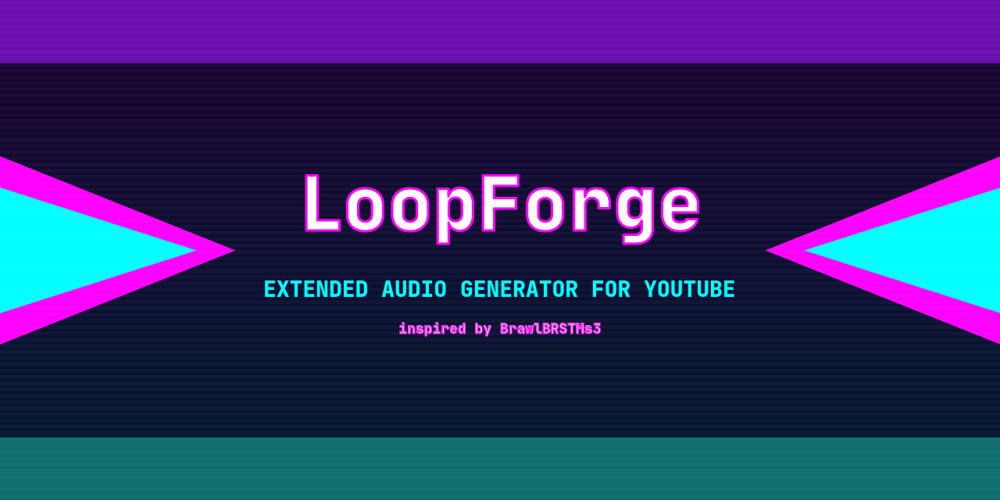
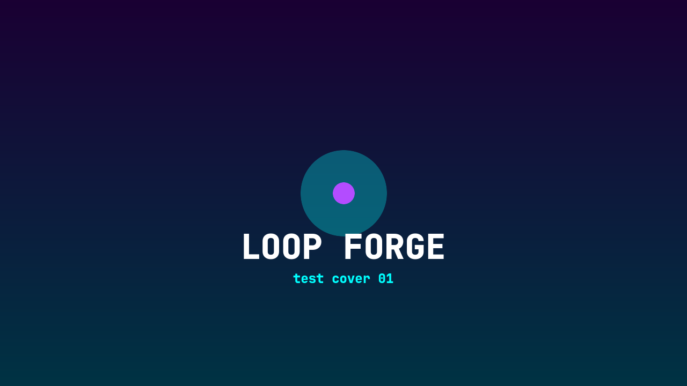
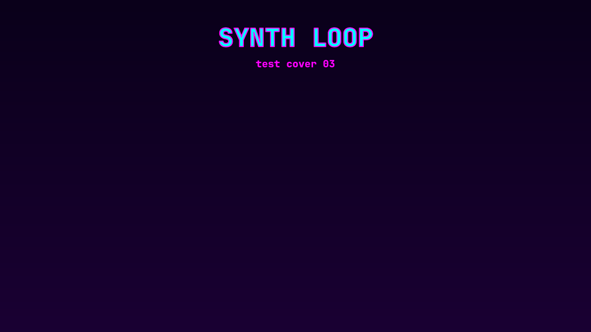
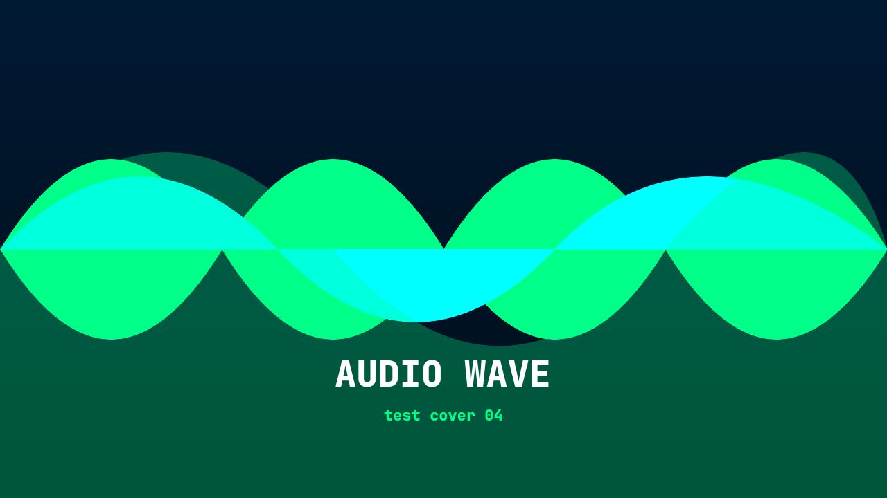

<div align="center">



# 🔥 LoopForge

### *Extended Audio Generator for YouTube*

**Extiende canciones y genera videos listos para subir — desde la terminal.**

[](https://www.gnu.org/software/bash/)
[](https://ffmpeg.org/)
[](LICENSE)
[]()

```
┌─────────────────────────────────────────────────────┐
│  🎵  toma tu audio  →  extiende el loop  →  🎬 mp4 │
└─────────────────────────────────────────────────────┘
```

[**Instalación**](#-instalación) · [**Uso**](#-uso) · [**Imágenes de prueba**](#-imágenes-de-prueba) · [**Acerca de**](#-acerca-de)

</div>

---

## 🎮 Inspirado por BrawlBRSTMs3

<div align="center">

> *Este proyecto nació pensando en el trabajo de **[BrawlBRSTMs3](https://www.youtube.com/@BrawlBRSTMs3)**,*
> *quien durante años extendió miles de pistas de videojuegos para YouTube,*
> *convirtiendo loops cortos en experiencias musicales interminables.*
>
> **LoopForge automatiza ese proceso.**

</div>

```
 ╔═══════════════════════════════════════════════════════════════════╗
 ║  BrawlBRSTMs3 extendió manualmente miles de canciones de juegos  ║
 ║  LoopForge lo hace por ti en segundos, desde la terminal.        ║
 ╚═══════════════════════════════════════════════════════════════════╝
```

---

## ✨ ¿Qué hace?

```
  🎵 cancion.mp3          🎛️ loopforge          🎬 cancion.mp4
 ┌──────────────┐      ┌──────────────┐      ┌──────────────────┐
 │  Audio corto │  →   │  Detecta el  │  →   │  Video 1280x720  │
 │  (loop de    │      │  loop point  │      │  con imagen      │
 │   juego)     │      │  y lo extiende│      │  portada         │
 └──────────────┘      └──────────────┘      └──────────────────┘
                              │
                     ┌────────┴────────┐
                     │  Listo para     │
                     │  subir a        │
                     │  YouTube  🚀    │
                     └─────────────────┘
```

### Flujo automático

| Paso | Descripción |
|:----:|-------------|
| ① | Detecta CPU/RAM y ajusta **procesamiento paralelo** automáticamente |
| ② | Filtra audios < 15s y elimina **duplicados** por hash MD5 |
| ③ | Extiende cada audio con **pymusiclooper** (detección de loop points) |
| ④ | Preprocesa la imagen de portada (**fondo difuminado** + cover centrada) |
| ⑤ | Renderiza el video en **1280×720** con ffmpeg (ultrafast + stillimage) |
| ⑥ | Organiza los videos en carpetas — **¡listo para YouTube!** |

---

## 🚀 Instalación

<details>
<summary><b>🐧 Arch Linux</b></summary>

```bash
sudo pacman -S ffmpeg yt-dlp imagemagick
pip install pymusiclooper
# Extras opcionales:
sudo pacman -S unrar jq
```
</details>

<details>
<summary><b>🦔 Ubuntu / Debian</b></summary>

```bash
sudo apt install ffmpeg yt-dlp imagemagick python3-pip
pip install pymusiclooper
# Extras opcionales:
sudo apt install unrar jq
```
</details>

<details>
<summary><b>🍎 macOS</b></summary>

```bash
brew install ffmpeg yt-dlp imagemagick
pip install pymusiclooper
```
</details>

```bash
git clone https://github.com/SrSlocko/loopforge.git
cd loopforge
chmod +x loopforge.sh
./loopforge.sh --help
```

---

## 📖 Uso

```bash
# 🎵 Canción individual
./loopforge.sh cancion.mp3 60 cover.jpg

# 📁 Carpeta completa (procesa en paralelo)
./loopforge.sh ./mi_musica 180 cover.jpg

# 📦 Archivo comprimido
./loopforge.sh album.zip 30 cover.jpg

# 🌐 Playlist de YouTube
./loopforge.sh "https://youtube.com/playlist?list=XXXXX" 60

# 🔀 Múltiples entradas (separadas por coma)
./loopforge.sh a.mp3 60 cover1.jpg , b.mp3 30 cover2.jpg

# 🧪 Modo tester (solo primer archivo)
./loopforge.sh cancion.mp3 60 cover.jpg -tester

# ⏰ Apagar el PC al terminar
./loopforge.sh cancion.mp3 60 cover.jpg -shutdown 30
```

### Entradas soportadas

| Tipo | Ejemplo | Descripción |
|------|---------|-------------|
| 🎵 Audio | `cancion.mp3` | MP3, WAV, FLAC, OGG, M4A |
| 📁 Carpeta | `./musica/` | Procesa todos los audios |
| 📦 ZIP | `album.zip` | Extrae y procesa todo |
| 📦 RAR | `album.rar` | Requiere `unrar` |
| 🌐 URL | `youtube.com/watch?v=...` | Descarga y genera video |
| 🌐 Playlist | `youtube.com/playlist?list=...` | Descarga la lista completa |

---

## 🖼️ Imágenes de prueba

Incluimos 4 portadas de ejemplo en [`docs/images/`](docs/images/) para que pruebes LoopForge sin necesidad de crear tu propia imagen:

<div align="center">
<table>
<tr>
<td align="center">
  <br>
  <sub><b>01 — Retro Purple</b></sub>
</td>
<td align="center">
  <br>
  <sub><b>02 — Sunset Drive</b></sub>
</td>
</tr>
<tr>
<td align="center">
  <br>
  <sub><b>03 — Synthwave Grid</b></sub>
</td>
<td align="center">
  <br>
  <sub><b>04 — Audio Wave</b></sub>
</td>
</tr>
</table>
</div>

```bash
# Prueba rápida con una imagen incluida:
./loopforge.sh cancion.mp3 30 docs/images/test_cover_03.png -tester
```

---

## ⚙️ Configuración

Edita las variables al inicio de `loopforge.sh`:

```bash
VIDEO_SIZE="1280x720"     # Resolución del video
VIDEO_FPS=25              # Frames por segundo
VIDEO_CRF=30              # Calidad (menor = mejor, rango: 18-28)
AUDIO_BITRATE="128k"      # Bitrate de audio AAC
MIN_AUDIO_SECS=15         # Audios más cortos se filtran
PARALLEL_JOBS=auto        # Se detecta automáticamente (CPU/RAM)
```

---

## 🖥️ Dependencias

| Dependencia | Estado | Para qué sirve |
|------------|:------:|----------------|
| `ffmpeg` + `ffprobe` | **Requerido** | Procesamiento de audio/video |
| `yt-dlp` | **Requerido** | Descarga de URLs y playlists |
| `pymusiclooper` | **Requerido** | Detección de loop points |
| `ImageMagick` | Opcional | Mejor portada (fallback: ffmpeg) |
| `unrar` | Opcional | Archivos `.rar` |
| `jq` | Opcional | Conteo rápido de playlists |

> **Nota:** Si ImageMagick no está instalado, LoopForge usa **ffmpeg como fallback** para procesar imágenes. Todo funciona igual.

---

## 🧠 Características

- **⚡ Procesamiento paralelo** — detecta tus núcleos CPU y RAM, ajusta trabajos solo
- **🎵 Detección inteligente de loop** — pymusiclooper analiza los puntos de repetición
- **🖼️ Portada automática** — fondo difuminado + imagen centrada (estilo YouTube)
- **🔄 Sin duplicados** — elimina archivos idénticos por hash MD5
- **🌐 Playlists de YouTube** — descarga y procesa listas completas
- **🧪 Modo tester** — procesa 1 archivo para probar configuración
- **⏰ Apagado programado** — apaga el PC después de terminar (00:01-07:00)
- **🐧🍎 Multi-plataforma** — Linux y macOS
- **💪 Sin dependencias raras** — solo 3 herramientas obligatorias

---

## 📁 Estructura del proyecto

```
loopforge/
├── loopforge.sh              # 🔥 Script principal
├── README.md                 # 📖 Este archivo
├── .gitignore                # 🚫 Archivos ignorados
└── docs/
    └── images/
        ├── banner.png         # 🎨 Banner del proyecto
        ├── test_cover_01.png  # 🖼️ Portada de prueba 1
        ├── test_cover_02.png  # 🖼️ Portada de prueba 2
        ├── test_cover_03.png  # 🖼️ Portada de prueba 3
        └── test_cover_04.png  # 🖼️ Portada de prueba 4
```

---

## 📄 Licencia

MIT — Úsalo, modifícalo, compártelo libremente.

---

<div align="center">

```
╔═══════════════════════════════════════════════════════════╗
║  Hecho con 🔥 para creadores de contenido en YouTube     ║
║  Inspirado en el legado de BrawlBRSTMs3                   ║
╚═══════════════════════════════════════════════════════════╝
```

**[⬆ Volver arriba](#-loopforge)**

</div>
